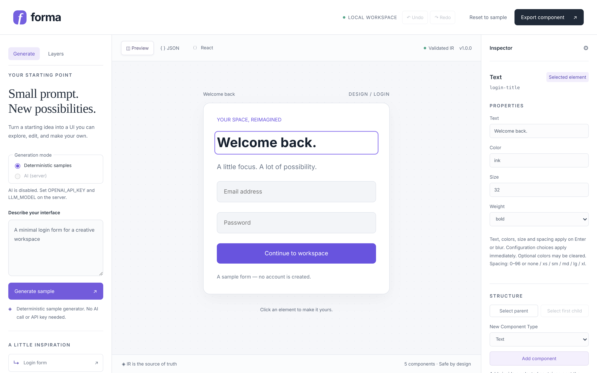
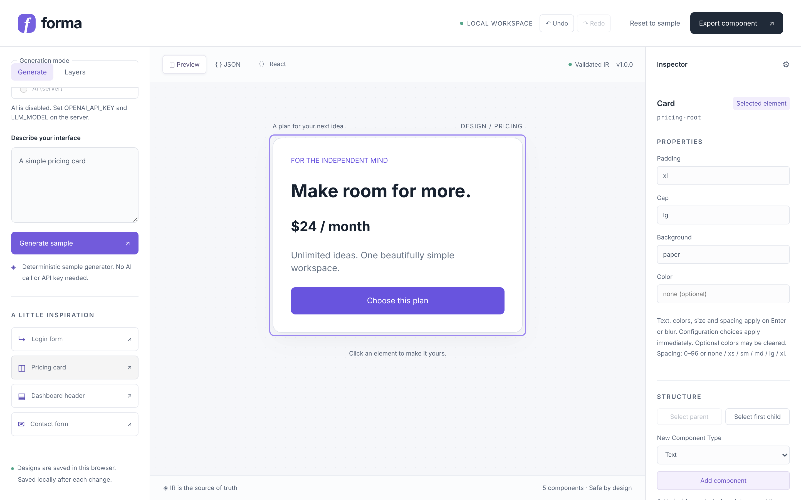
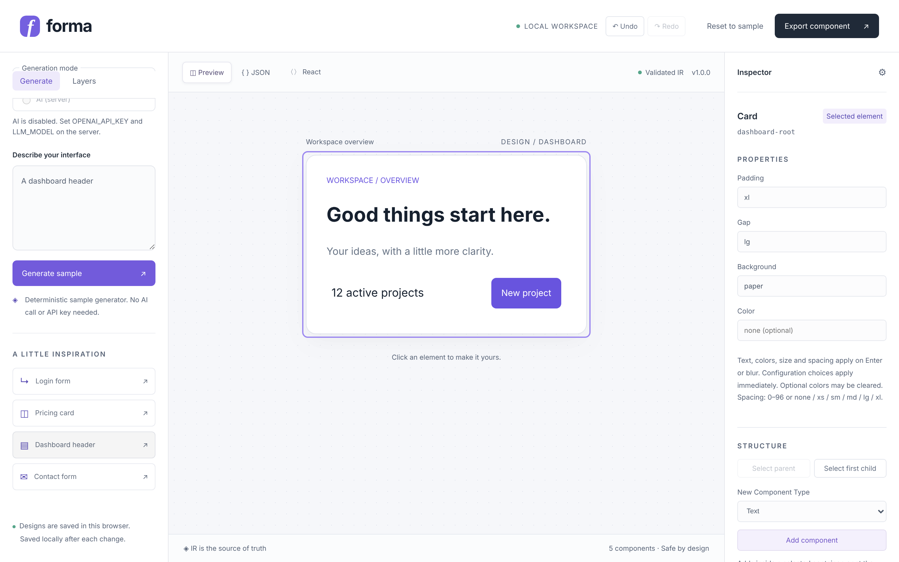
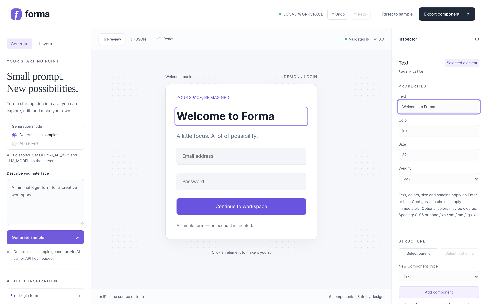
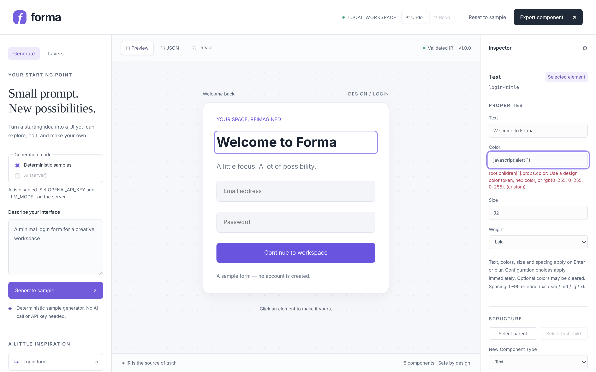
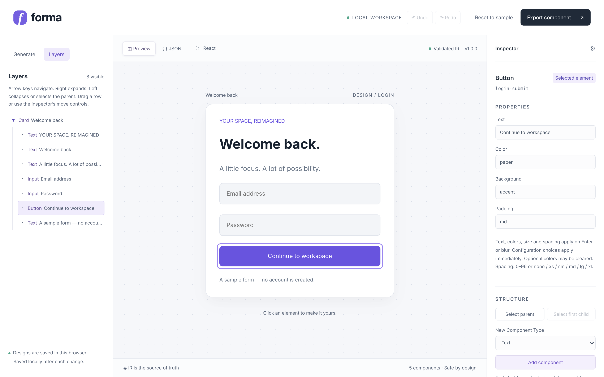
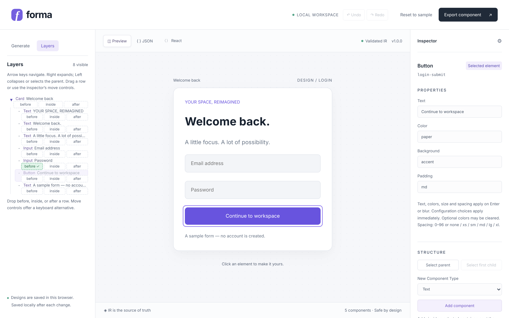
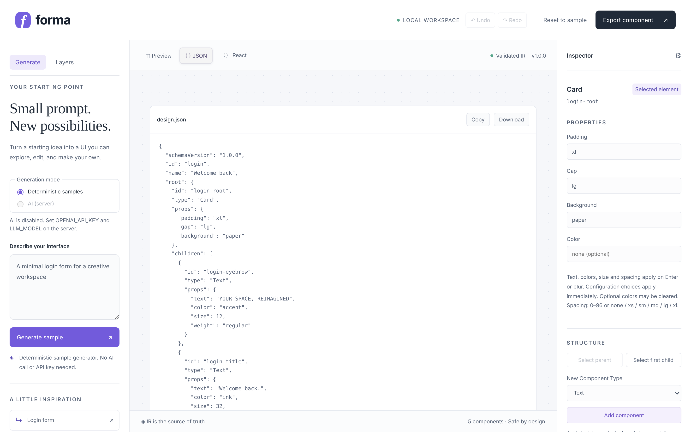
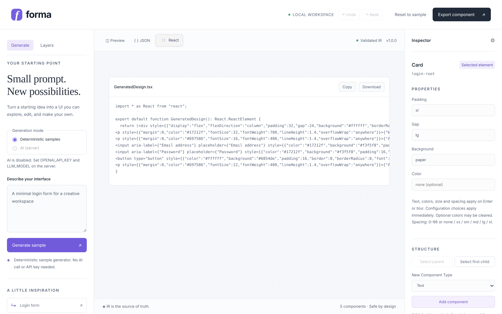
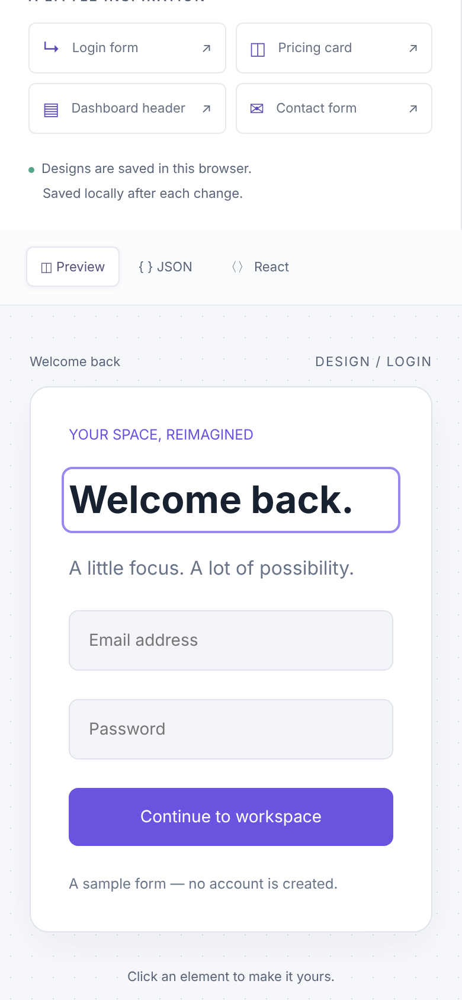

# Forma — AI Design Studio

Describe an interface, get a small interactive UI, then edit it, restructure it and export it as JSON or a React component. Everything is built on one validated, versioned **JSON intermediate representation (IR)**: templates, AI output, the editor, the preview and the exports all go through the same schema, so a design is either valid or it is rejected.



**What you can do**

- Start from four deterministic templates (no AI call, no key) or, optionally, from one AI provider that may only answer in IR JSON.
- Click anything in the preview to edit it in the **Inspector**; invalid values are refused with a precise path-and-code message.
- Inspect and rearrange the structure in the **Layers** tree: keyboard navigation, move controls, native drag and drop.
- **Undo / redo** (Ctrl/Cmd+Z), automatic local persistence, **JSON** and **React (TSX)** export.

## Quick start

Requires **Node 24.x** and npm >= 8.15 (`.nvmrc` and `engines` enforce it). No database, UI framework or hosted service is needed for the templates.

```sh
nvm install && nvm use
npm ci
npm run dev
```

Open http://127.0.0.1:5173. `npm run dev` starts the TypeScript API server (127.0.0.1:3001) and Vite (127.0.0.1:5173) together; Vite proxies `/api`. Without an API key the server still starts, reports AI as disabled and the templates work normally. `npm run dev:server` / `npm run dev:client` start the two halves separately.

## A tour

### 1. Start from a template

Four starting points — login form, pricing card, dashboard header, contact form — are one click away. The generator picks a template from keywords in your prompt (pricing/plan/subscription first, then dashboard/header/overview, then contact/message, otherwise login). Prompt text is never embedded in a design.

| Pricing card                                              | Dashboard header                                                |
| --------------------------------------------------------- | --------------------------------------------------------------- |
|  |  |

### 2. Edit with the Inspector

Click an element, change a property, press Enter or leave the field. Text, placeholder, colors, spacing, Text size/weight and Stack direction/alignment/justification are all editable. Optional colors can be cleared.



### 3. Invalid input is refused, not repaired silently

Colors must be design tokens (`ink`, `muted`, `paper`, `surface`, `accent`, `line`), a hex color or `rgb(...)`. Spacing is 0–96 or `none`, `xs`, `sm`, `md`, `lg`, `xl`. Anything else keeps the accepted design unchanged and explains why.



### 4. Understand and restructure with Layers

Switch the left panel to **Layers**. The tree and the preview share one selection. Use Up/Down/Home/End, Right to expand, Left to collapse or select the parent. Add, remove, move up/down or change parent from the inspector's **Structure** section; those are the keyboard alternatives to dragging.



### 5. Drag and drop

Drag a row onto a **before / inside / after** target. Targets show allowed (green ✓) or blocked (red ×) feedback and every move runs the same validation as the move controls (no cycles, nesting depth or node-count violations). Releasing anywhere else moves nothing and creates no history entry.



### 6. Export

Copy or download the validated IR, or a deterministic React component generated from it. Clipboard failures offer Download instead. Generated components need a React 18+ TypeScript host.

| JSON                                           | React (TSX)                                      |
| ---------------------------------------------- | ------------------------------------------------ |
|  |  |

### 7. On a phone

The shell stacks on small screens. Generating or exporting scrolls the result into view and announces it to screen readers.



## Optional AI setup

```sh
cp .env.example .env
```

Edit `.env` locally: set `OPENAI_API_KEY` and `LLM_MODEL` to a model identifier available to your account that supports the Responses API JSON mode. There is deliberately no default model. Review the [official model catalog](https://developers.openai.com/api/docs/models) for the model's capabilities, restart the dev processes after changing server settings, and never put secrets in a `VITE_*` variable or commit `.env`.

Choose **AI (server)** once availability is detected. AI sends your prompt to OpenAI, may incur costs and is not deterministic. The accepted design stays browser-local; the prompt and generated IR cross the provider boundary. **No live provider generation has been verified** because no key/model was configured during development. Mock-provider tests and offline evaluations are verified separately.

| Environment variable                                       | Default / constraint                                                            |
| ---------------------------------------------------------- | ------------------------------------------------------------------------------- |
| `OPENAI_API_KEY`                                           | Empty disables AI                                                               |
| `LLM_MODEL`                                                | No default; required with a key                                                 |
| `API_PORT`                                                 | 3001, 1024–65535; Vite proxy reads the same setting                             |
| `LLM_MAX_PROMPT_LENGTH`                                    | 4000, 1–8000 characters; UI accepts up to 4000                                  |
| `LLM_MAX_OUTPUT_TOKENS`                                    | 4096, 256–12000 per attempt                                                     |
| `LLM_TIMEOUT_MS`                                           | 30000, 100–120000 across generation and all repairs                             |
| `LLM_REPAIR_ATTEMPTS`                                      | 1, allowed 0–2                                                                  |
| `LLM_RATE_LIMIT` / `LLM_RATE_WINDOW_MS`                    | 6 per 60000 ms, global in-memory local limit; one active generation             |
| `LLM_MAX_OUTPUT_BYTES`                                     | 100000, 1000–200000                                                             |
| `LLM_REPAIR_BYTES`                                         | 12000, 1000–20000; bounded invalid-output excerpt                               |
| `LLM_SUPPORTS_TEMPERATURE`                                 | false; set true only if the chosen model supports temperature, then 0.2 is sent |
| `LLM_INPUT_USD_PER_MILLION` / `LLM_OUTPUT_USD_PER_MILLION` | Optional operator-supplied live-eval cost rates                                 |

SDK automatic retries and logging are disabled; `store:false` is requested. Provider errors are returned as safe structured errors, without raw exception text. This is a development server, not a public production API.

## How it works

- **IR is the single source of truth.** Five components (Stack, Text, Button, Input, Card), validated with Zod. The preview renders only known types and ignores unknown props; exports come from templates, never from model text.
- **AI output is untrusted.** The server asks for IR JSON only, validates it, runs a bounded repair loop, and the client revalidates the final response. Provider errors are returned as safe structured errors.
- **Local-first.** Accepted changes save to `localStorage` (`forma.design.v1`); reload restores through migration/validation, and corruption or unavailable storage fall back visibly. Reset replaces the design with the login sample.

See [architecture and threat model](docs/ARCHITECTURE.md).

## Checks and evaluations

```sh
npm run build
npm run lint
npm run typecheck
npm test
npm run format:check
npm run eval:offline
npm audit
```

`npm run format` formats files. Build output is in `dist/`; it is the **client only**. There is no production deployment workflow. Tests include structural editing/history/tree/drag events, server/provider mocks, client AI controls, canary-secret bundle isolation, eval math and all original test cases. CI runs formatting, lint, typecheck, tests, offline eval and build; it never calls OpenAI. Workflow YAML was checked locally; remote CI execution has not been observed.

`npm run eval:live` is manual and billable, requires key/model, and writes ignored local results. See [eval documentation](docs/EVALS.md) for the 30-prompt corpus, metrics, synthetic offline results and honest limitations.

## Scope and limitations

Five supported components: Stack, Text, Button, Input, Card. AI can compose only those components; unsupported requests must be approximated and invalid output rejected. No provider-side guarantee replaces Zod. Delimiters reduce prompt ambiguity but do not solve prompt injection; safety comes from validation and inert rendering/export templates.

No progress SSE is implemented; the client waits for a complete validated result. No multiple providers, chat editing, additional component types, authentication, collaboration, billing, database, uploads, plugins, animations, multi-select or generated responsive variants. The studio shell adapts to small screens, without adding a design breakpoint model.

One unencrypted browser-local design; no backup, cross-tab coordination or import UI. Generation/reset replaces it. Cancellation is best-effort upstream and cannot refund tokens already consumed. In-memory rate limiting is dev-grade and resets on server restart. CSP, production security/accessibility audits, observability, performance budgets and deployment remain planned.

## Editing reference

Switch the left panel from **Generate** to **Layers** to inspect the hierarchy. Tree and preview share one selection and inspector. Use Up/Down, Home/End to navigate visible rows; Right expands or selects the first child; Left collapses or selects the parent. Selecting an element in the preview reveals its ancestors in the tree. Disclosure state is local to the Layers panel and resets when switching panels.

The inspector covers every existing prop: text/placeholder, colors, spacing, Text size/weight and Stack direction/alignment/justification. Configuration dropdowns apply immediately; text/numeric fields apply on Enter/blur. Invalid drafts remain inline without replacing the accepted design. Optional colors can be cleared. Accepted changes retain input focus.

Use **New component type → Add component** for Stack, Card, Text, Button or Input. Addition selects the new node and places it inside the selected container, or appends to the selected leaf's parent. **Remove component** also removes descendants. The root cannot be removed or moved. **Move up/down** reorders siblings; **Parent container** reparents to a permitted container, appending the subtree. These controls are keyboard alternatives to dragging.

Drag a Layers row to its **before / inside / after** targets. Targets stay in place and show allowed/blocked feedback. Only node IDs from an active drag in this tree are accepted; external text, HTML, files and JSON are not imported. Every move uses the same validation as the move controls; invalid nesting/cycles/depth/count violations are rejected. Touch-native dragging and cross-browser pointer behavior have not been audited; use the keyboard controls when needed.

**Undo/Redo** covers property changes, insertion, subtree removal, reordering, reparenting, generated replacements and reset. Ctrl/Cmd+Z undoes; Ctrl/Cmd+Shift+Z and Ctrl+Y redo outside editable fields, where native text undo is left alone. Selection and rejected/no-op operations create no history. A new accepted edit clears redo. History is memory-only, with a shared maximum of 40 snapshots and 4 MiB of serialized UTF-8 snapshot data, dropping farthest states first. This bounds retained payload, not total JavaScript heap usage. Reload clears history and restores only the validated current design. Reset is undoable, so it is not secure erasure; export important work before replacing it.

Accepted edits/undo/redo cancel pending AI generation. Late responses cannot overwrite the newer design even if the transport ignores abort. Cancellation cannot refund provider tokens already consumed.

Phase 3's required audit found a Zod advisory. The project now uses patched Zod 4.6.7 and its native JSON Schema exporter; IR v1 limits and public diagnostic codes remain stable. No new editor dependency was added, and the obsolete converter was removed.

See the [polish pass record](docs/POLISH-PASS.md), [Phase 3 verification](docs/PHASE3-VERIFICATION.md), [architecture and threat model](docs/ARCHITECTURE.md), [roadmap](docs/ROADMAP.md), [Phase 2 verification](docs/PHASE2-VERIFICATION.md), and the historical [Phase 1 report](docs/VERIFICATION.md).
